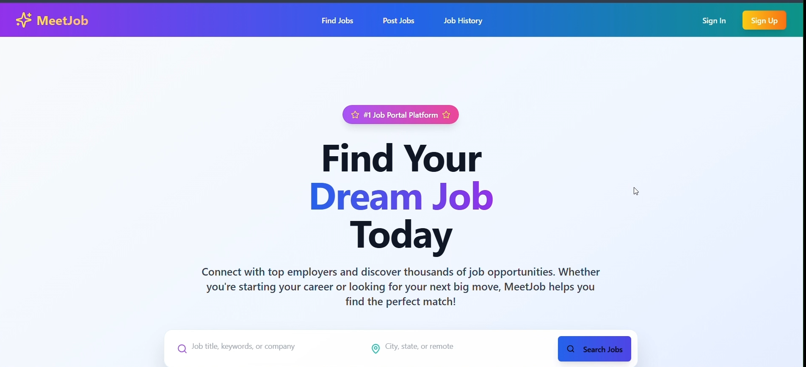
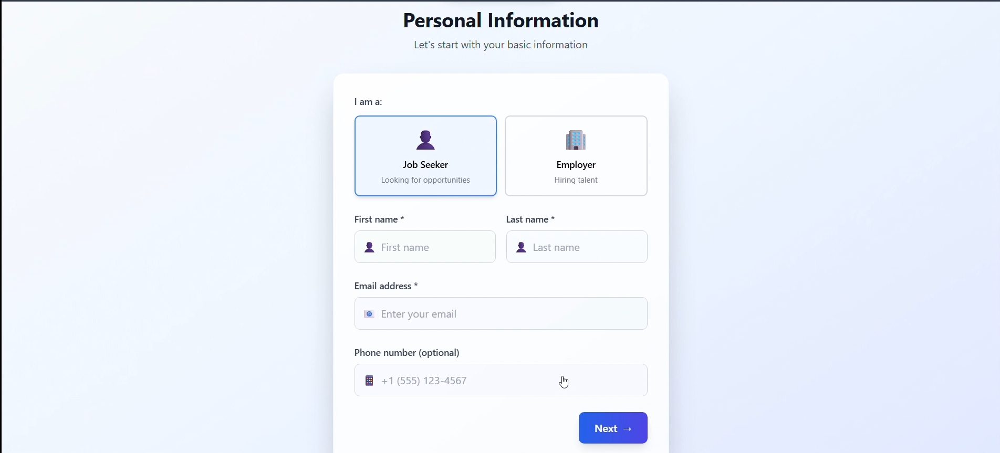
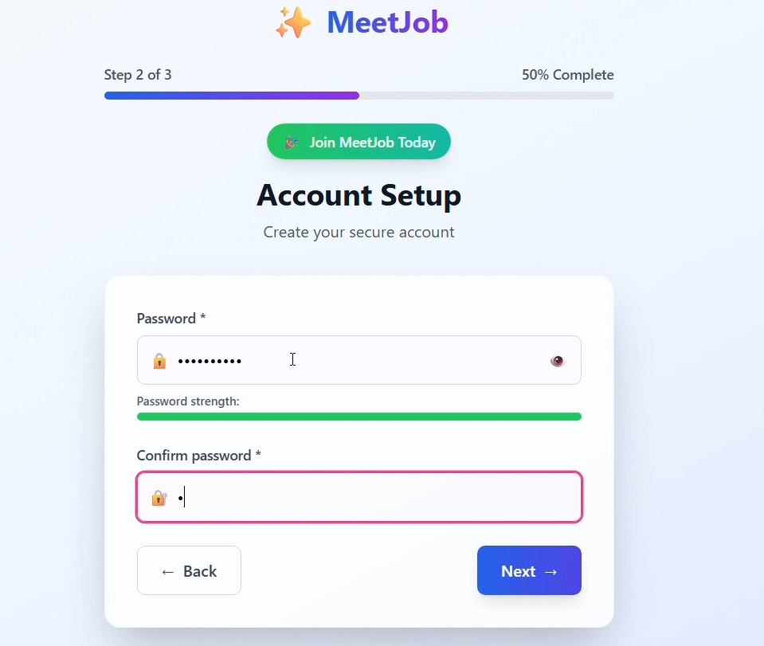
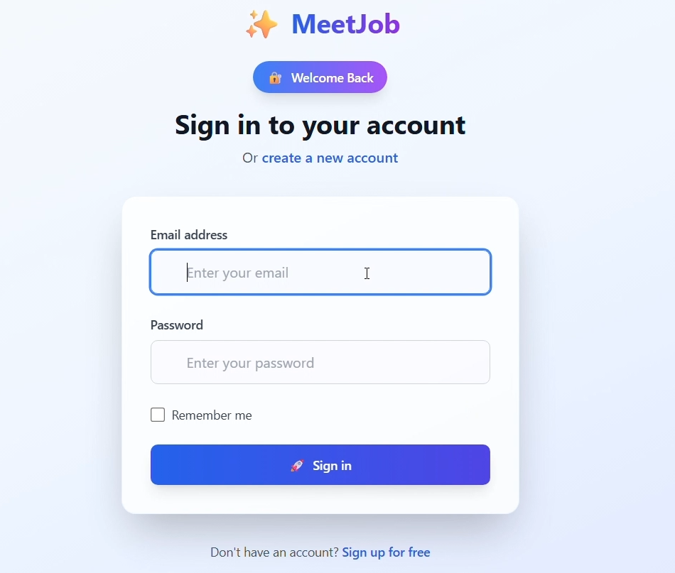
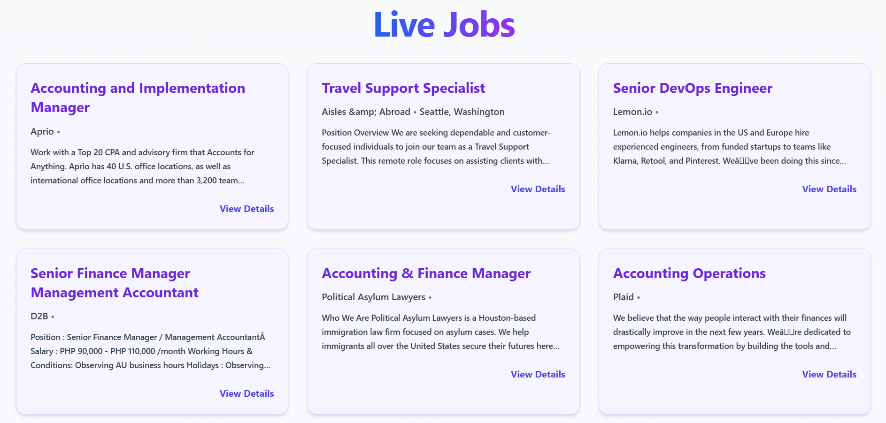

# 🧑‍💼 MeetJob - Job Portal Web Application

A full-stack Job Portal built using **Spring Boot**, **React.js**, and live job data from **RemoteOK** with **JWT Authentication**.

---

## 🚀 Features

- 🔐 User Authentication (JWT-based Sign In / Sign Up)
- 📝 Post and Search Jobs by Title and Location
- 📄 View Job Details and Apply
- 🧠 User role management (USER / ADMIN ready)
- 🌐 Responsive UI with Tailwind CSS and ShadCN
- 🔄 Secure Login + Logout with Token Management
- ✅ CORS and Axios configured for cross-origin requests
- 🌍 Live remote job listings from RemoteOK
- 🔍 Search filtered on live job results

---

## 🧱 Tech Stack

| Frontend     | Backend        | Database    | Auth      | Live Data Source |
|--------------|----------------|-------------|-----------|------------------|
| React.js     | Spring Boot    | PostgreSQL  | JWT       | RemoteOK API     |

---

## 📁 Project Structure

```bash
Job-Portal/
├── jobportal-backend/
│   └── src/
│       └── main/
│           └── java/com/example/jobportal/
│               ├── config/
│               ├── controller/
│               ├── model/
│               ├── repository/
│               ├── security/
│               ├── service/
│               └── JobportalApplication.java
│
├── jobportal-frontend/
│   └── src/
│       ├── components/
│       ├── context/
│       ├── hooks/
│       ├── lib/
│       ├── services/
│       └── App.js
│
├── README.md
├── .gitignore
└── package.json
```

---

## ⚙️ Setup Instructions

### ✅ Backend (Spring Boot)

1. Open the backend folder:
```bash
cd jobportal-backend
```

2. Install dependencies:
```bash
./mvnw clean install
```

3. Run the backend:
```bash
./mvnw spring-boot:run
```

4. Backend will run on:
```bash
http://localhost:8081
```

---

### ✅ Frontend (React.js)

1. Navigate to the frontend:
```bash
cd jobportal-frontend
```

2. Install dependencies:
```bash
npm install
```

3. Start the frontend:
```bash
npm start
```

4. Frontend will run on:
```bash
http://localhost:3000
```

---

## 🌍 Live Jobs Integration

This project fetches live remote job postings from the RemoteOK API.

### Backend endpoint
```bash
GET /api/jobs/live
```

This endpoint calls:
```bash
https://remoteok.com/api
```

and returns live job data that is displayed on the homepage.

---

## 🔐 Authentication

- Login & Registration with JWT
- Token is stored in `localStorage`
- Authenticated requests include:
```bash
Authorization: Bearer <token>
```

---

## 🔧 Environment Variables

### Frontend local development
Edit:
```bash
jobportal-frontend/.env.development
```

Add:
```env
REACT_APP_API_URL=http://localhost:8081
```

### Frontend production
Edit:
```bash
jobportal-frontend/.env.production
```

Example:
```env
REACT_APP_API_URL=https://your-backend-url.onrender.com
```

---

## 🗄️ Database Configuration

The project uses PostgreSQL.

Update:
```bash
jobportal-backend/src/main/resources/application.properties
```

Example:
```properties
spring.datasource.url=jdbc:postgresql://your-host:5432/your-db-name
spring.datasource.username=your-db-user
spring.datasource.password=your-db-password
spring.datasource.driver-class-name=org.postgresql.Driver

spring.jpa.hibernate.ddl-auto=update
spring.jpa.show-sql=false
```

---

## 🌐 Deployment Instructions

### Frontend Deployment
Use platforms like:
- Vercel
- Netlify

Set this environment variable:
```env
REACT_APP_API_URL=https://your-backend-url
```

### Backend Deployment
Use platforms like:
- Render
- Railway
- Fly.io
- Azure

Also make sure your backend is configured with:
- a live PostgreSQL database
- valid CORS settings
- proper production environment variables

---

## ✅ CORS Configuration

For local and production environments, your backend must allow requests from the frontend origin.

Example:
```java
http://localhost:3000
https://your-frontend.vercel.app
```

This is important so the frontend can call backend APIs successfully.

---

## 💡 Future Improvements

- Role-based job posting (Admin only)
- Job application tracking system
- File upload (Resume/CV)
- Pagination + Search Filters
- Save live jobs to the database
- Add employer dashboard and analytics

---

## 📸 Screenshots







---

## 🧑‍💻 Author

Made with ❤️ by [Rohit Rawat]

---

## Notes

This project is currently running with:
- live job data from RemoteOK
- local or cloud PostgreSQL for app data
- React frontend for user interface
- Spring Boot backend for API and security

When pushing to GitHub:
- frontend and backend should be deployed separately
- GitHub itself does not host the Java backend directly
- use Vercel for frontend and Render or similar for backend
